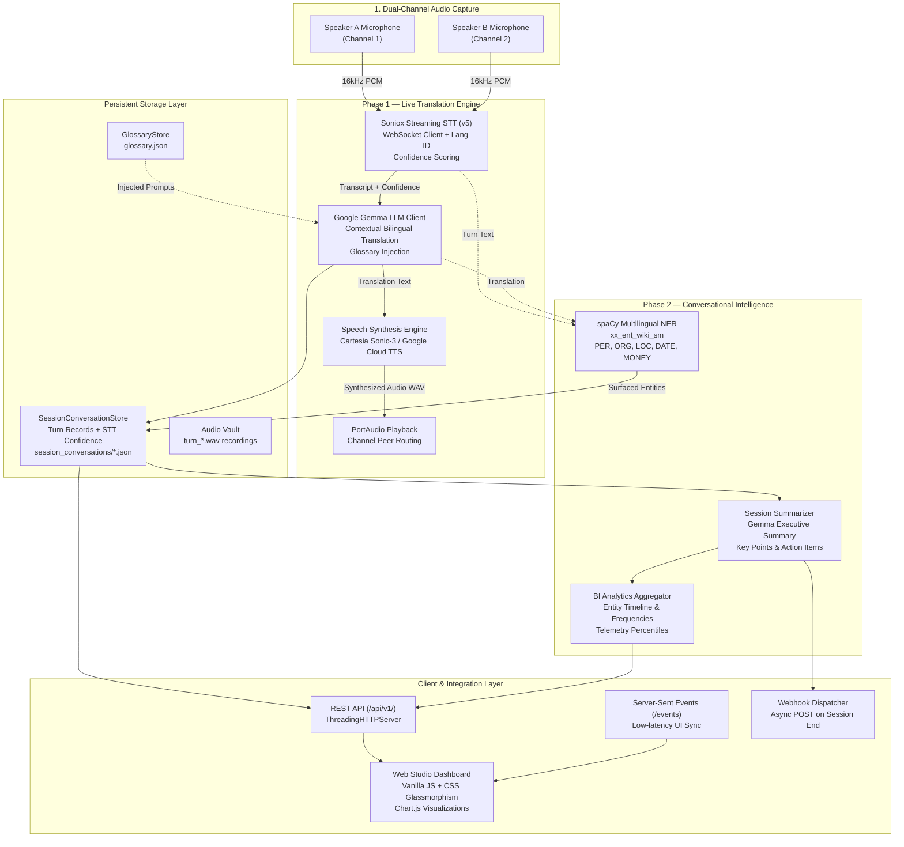

# System Architecture — Kinesia

> **Real-Time Bilingual Speech Translation & Conversational Entity Extraction Platform**  
> *B.Tech Final Year Industry Project · Dept. of AI & ML · Markytics.AI*

---

## 1. High-Level Architecture

Kinesia provides continuous, bi-directional speech-to-speech translation between two participants while simultaneously running local Named Entity Recognition (NER) and session-level Conversational Intelligence.



---

## 2. Core Subsystems

### 2.1 Audio Ingestion & Playback (`pi_translator/audio.py`)
- **PortAudio + sounddevice**: Captures single-channel 16-bit PCM at 16,000 Hz.
- **Voice Activity Detection (VAD)**: Energy-based silence detection with configurable thresholds (`VOICE_ACTIVITY_THRESHOLD`, `VOICE_SILENCE_SECONDS`).
- **Low-Latency Streaming**: Utterances are chunked (100 ms) and pushed to Soniox over WebSockets.

### 2.2 Streaming STT & Language Identification (`pi_translator/soniox_client.py`)
- **Engine**: Soniox Real-Time WebSocket API (`stt-rt-v5`).
- **Confidence Scoring**: Computes turn confidence as a composite of token language consistency and individual token acoustic probabilities:
  $$\text{Confidence} = 0.70 \times \bar{c}_{\text{tokens}} + 0.30 \times \frac{w_{\text{dominant}}}{\sum w_i}$$
- **Zero Fabrication**: Confidences below 0.70 trigger a visual `⚠ Low Confidence` badge on the dashboard.

### 2.3 Translation & Glossary Enforcement (`pi_translator/translation/`, `gemma_client.py`)
- **Engine**: Google Gemma LLM via high-throughput OpenAI-compatible completions endpoint.
- **Glossary Injection**: Custom terms in `glossary.json` are detected in source utterances and injected into the Gemma system prompt:
  > *"Preserve these terms exactly as-is: TechCorp, Project Alpha, Dr. Sharma."*
- **Temperature**: $T=0.0$ for deterministic, faithful translation.

### 2.4 Text-to-Speech Synthesis (`pi_translator/tts/`, `cartesia_client.py`, `google_tts_client.py`)
- **Cartesia Sonic-3**: Ultra-low latency voice synthesis (sub-350 ms).
- **Google Cloud TTS**: High-fidelity neural voice synthesis for Indian regional languages (Hindi, Telugu, Tamil, Marathi, etc.).

### 2.5 Named Entity Recognition (`pi_translator/nlp/entity_extractor.py`)
- **Engine**: spaCy multilingual entity recognition (`xx_ent_wiki_sm`).
- **Bidirectional Verification**: Evaluates both the source transcript and target translation to prevent entity loss across code-switched phrases.
- **Surfaced Entities**: `PERSON`, `ORG`, `LOC`, `GPE`, `DATE`, `TIME`, `MONEY`, `PRODUCT`.

### 2.6 Session Intelligence & Summarization (`pi_translator/nlp/summarizer.py`)
- **Trigger**: Automatic on session end or manual on-demand via `POST /api/v1/insights/{id}/summarize`.
- **Outputs**:
  - Executive summary (2-4 concise sentences)
  - Key discussion points
  - Action items (strict empty list `[]` if no tasks were discussed)
  - Entity table aggregated across all turns.

---

## 3. Data Flow & Persistence

All session artifacts are persisted under `session_conversations/`:
```
session_conversations/
├── <session_id>.json            # Complete turn log with latency, confidence, and entities
├── <session_id>_summary.json    # NLP summary, key points, action items
└── <session_id>_audio/          # (Opt-in) 16kHz WAV recordings of turns
    ├── turn_000_ch1.wav
    └── turn_001_ch2.wav
```
