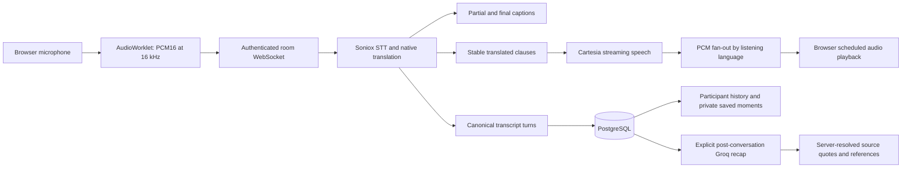

# Kinesia architecture

## Current browser product

Render runs one Docker web service and PostgreSQL. The service serves the React
build from `backend/web`, the authenticated API, and the room WebSocket on the
same origin. With `TRANSLATION_PROVIDER=soniox`, startup selects
`backend/realtime_server.py`. Provider credentials remain on the server.

The WebSocket starts with an authentication JSON message, then accepts binary
mono PCM16 and JSON configuration/activity controls. Soniox opens one route per
speaker and required listening language; listeners sharing a language share
the synthesized output. Partial hypotheses update captions. Only stable text
enters TTS. Clauses within one utterance share a Cartesia context, while each
transport stream has its own ID and sequence numbers.

`backend/realtime_rooms.py` owns provider routes, output queues, listeners,
interruption state, and bounded shutdown. `backend/rooms/coordinator.py` owns
membership, persisted host permissions, canonical turn merging, and lifecycle
events. A primary recognition route supplies the canonical source transcript;
parallel routes contribute translations aligned by audio time and capture epoch.
Identical words alone never identify a duplicate utterance.

Muting stops outgoing capture without resetting incoming playback. Retiring
routes flush recognition and drain queued synthesis within a deadline. A
listening-language change resets incoming audio to avoid playing the old
language. Sustained voice activity plus fresh recognized text can interrupt
stale speech; short acknowledgements do not automatically take the floor.
These are conservative heuristics, not perfect intent recognition.

## Persistence and privacy

PostgreSQL stores accounts, room ownership/membership, recorded transcripts,
legacy extractive insights, private saved moments, and AI recap status/results.
SQLite is the isolated local-test fallback and enforces foreign keys too.
Startup applies additive schema/index initialization; initialization failures
must be visible rather than silently ignored.

Leaving does not transfer host ownership. A returning creator can end the room.
Passcode verification grants membership without claiming the user is online;
the live coordinator supplies presence. Replacing a tab changes subscription
ownership. Account deletion revokes active guest connections as well as hosted
rooms after the database transaction succeeds.

Personal history removal hides a conversation for that account; it does not
delete another participant's history or the shared source. Host-only transcript
clearing removes derived recaps/bookmarks and blocks delayed STT from restoring
pre-clear speech. Saving resumes with a new phrase. Conversations created with
recording disabled have no persisted transcript, bookmarks, or AI recaps.

## Recaps

Groq is independent of live speech and runs only after an explicit request for
an ended, recorded conversation. The backend processes long inputs in bounded
batches, validates structured output, and resolves provider-selected passage
references to actual turn IDs and exact original quotes. Invalid references
receive one bounded repair attempt, then an explicit failure. Grounded citations
do not guarantee that the model interpreted every statement correctly.

Recap jobs run in a separate worker with bounded queue/deadline/rate-limit
handling and persisted status. A restart makes interrupted jobs retryable.
No generated success is substituted for a missing key or a failed provider.

## Compatibility entry points

The repository retains the workstation/CLI pipeline (`backend/cli.py`,
`backend/pipeline.py`, `backend/audio.py`), optional provider adapters, glossary
and evaluation tools, and REST/SSE compatibility routes in
`backend/dashboard_server.py`. Their host audio devices and local
`session_conversations/` artifacts are separate from browser-room persistence.
They are not the Render microphone transport. Gemma/Google/Edge adapters do not
participate in the configured Soniox/Cartesia browser path.

## Operational limits and verification

Live rooms are process-local: use one worker and one instance. Admission currently
allows at most eight participants and the configured listening-language limit
(default four), checked atomically. These are guardrails, not a load-test result.
Bounded queues may skip stale audio and report overload; captions/transcripts
remain available. No fixed end-to-end latency or unlimited scale is promised.

See [Render deployment and call tests](RENDER_DEPLOYMENT.md),
[API reference](api.md), and [audit evidence](KINESIA_AUDIT_FIXES.md).
